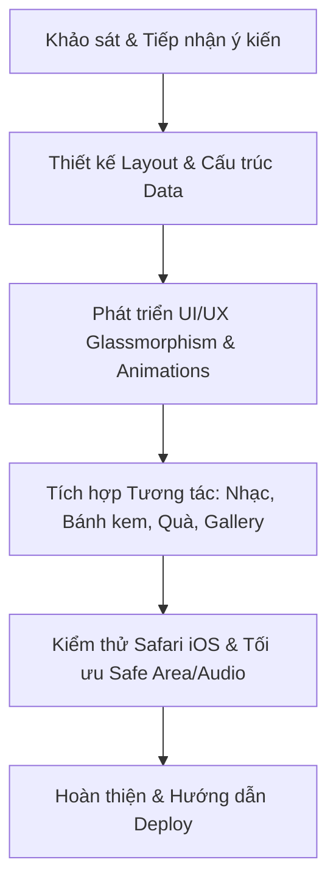

# 🎂 KẾ HOẠCH PHÁT TRIỂN WEBSITE SINH NHẬT (OPTIMIZED FOR MOBILE SAFARI)

> **Vị trí file:** `PLAN.md` (Root project)  
> **Mục tiêu:** Xây dựng website chúc mừng sinh nhật cá nhân hóa, giao diện đẳng cấp (premium), chuyển động mượt mà và tối ưu hóa 100% cho trải nghiệm trên trình duyệt **Safari iOS (iPhone / iPad)**.

---

## 📋 PHẦN 1: BẢNG KHẢO SÁT Ý KIẾN (SURVEY)
*Bạn có thể copy phần này, tích chọn `[x]` hoặc điền nội dung trực tiếp để phản hồi.*

### 1. Đối tượng nhận & Phong cách (Tone & Mood)
- [x] **A. Người yêu / Crush:** Lãng mạn, ngọt ngào, ấm áp, tông hồng pastel/đỏ rượu/rose gold.
- [ ] **B. Bạn thân / Đồng nghiệp:** Năng động, hài hước, hiện đại, tông vàng gold/neon/dark mode sang trọng.
- [ ] **C. Người thân trong gia đình (Bố, mẹ, anh chị em):** Tinh tế, chân thành, sâu lắng, tông màu thanh lịch.
- [ ] **D. Phong cách khác:** *(Ghi chú cụ thể)*: `.........................`

---

### 2. Thông tin cá nhân hóa (Personal Details)
- **Tên / Biệt danh người nhận:** `Em bé iuuu ❤️`
- **Ngày sinh nhật chính xác:** `01 / 09 / 2003`
- **Lời chúc / Thông điệp chính:** `Chúc em bé tuổi mới...`
- **Tên người gửi (nếu có):** `Anh iu cụa eim ❤️`

---

### 3. Các tính năng & Tương tác đặc biệt mong muốn
*(Bạn có thể chọn nhiều tính năng)*
- [x] **1. Màn hình khóa / Mở đầu ấn tượng:** Đồng hồ đếm ngược, hiệu ứng gõ chữ (Typewriter), hoặc chạm mở màn nhung.
- [x] **2. Thổi nến sinh nhật tương tác:** Bánh kem sinh nhật ảo với ngọn nến động, chạm (hoặc thổi vào mic nếu hỗ trợ) để dập tắt nến và kích hoạt pháo hoa.
- [x] **3. Trình phát nhạc nền (Music Player):** Tự động hoặc nút phát/dừng bài hát yêu thích (lưu ý cơ chế tương tác kích hoạt âm thanh trên Safari).
  - *Tên bài hát / Link nhạc gợi ý:* `https://www.youtube.com/watch?v=vhVBWw6rId0`
- [ ] **4. Thư viện ảnh kỷ niệm (Photo Memories):**
  - [ ] Kiểu ảnh chụp lấy liền (Polaroid frame) nghiêng nghệ thuật.
  - [x] Kiểu Carousel trượt ngang mượt mà bằng cử chỉ vuốt (Swipe gesture).
  - [ ] Kiểu Timeline dòng thời gian kỷ niệm.
- [ ] **5. Thư tay bí mật (Interactive Letter/Envelope):** Hiệu ứng mở phong bì thư hé lộ bức tâm thư dài.
- [x] **6. Mini-game cào trúng thưởng (Scratch Card):** Dùng ngón tay cào lớp tráng bạc để xem món quà hoặc lời chúc bí mật.
- [x] **7. Hiệu ứng hạt tương tác (Particle Effects):**
  - [x] Pháo giấy (Confetti) rực rỡ
  - [x] Trái tim / Ngôi sao lấp lánh rơi
  - [x] Bong bóng bay bồng bềnh

---

### 4. Tông màu & Giao diện chủ đạo (Color Palette)
- [ ] **Dark Luxury:** Nền đen than/tím đậm huyền bí kết hợp ánh vàng Gold / Rose Gold lấp lánh (Hiện đại & Sang trọng).
- [ ] **Romantic Pastel:** Trắng ngà, hồng phấn, tím lavender (Dịu dàng & Ngọt ngào).
- [ ] **Minimalist Aesthetic:** Trắng tinh khôi, be sữa, xám nhạt, phông chữ thanh mảnh (Đơn giản & Tinh tế).
- [ ] **Vibrant Celebration:** Màu sắc tươi sáng, rực rỡ, lễ hội vui tươi.
- [x] **Tone Hồng pastel:** Hồng pastel/Trắng ngà/Xanh mint. Màu sắc tươi sáng, rực rỡ, lễ hội vui tươi.

---

## 📱 PHẦN 2: ĐẶC TẢ TỐI ƯU CHO MOBILE SAFARI (IOS)

Website sẽ được tinh chỉnh kỹ thuật để đạt chuẩn cao nhất trên iOS Safari:

1. **Xử lý Viewport & Kích thước màn hình:**
   - Sử dụng đơn vị `100dvh` (Dynamic Viewport Height) thay vì `100vh` để giao diện không bị giật, vỡ khi thanh địa chỉ Safari ẩn/hiện lúc cuộn.
   - Thêm `viewport-fit=cover` và `safe-area-inset-*` (Top/Bottom/Left/Right) để không bị che bởi Dynamic Island, Tai thỏ (Notch) và Thanh gạt Home Indicator.

2. **Trải nghiệm cảm ứng (Touch & Gestures):**
   - Kích thước điểm chạm (Touch Targets) đạt chuẩn tối thiểu `44px x 44px` theo Apple HIG.
   - Vô hiệu hóa phóng to/thu nhỏ ngoài ý muốn (`user-scalable=no`, `touch-action: manipulation`).
   - Tắt hiệu ứng bôi đen xám mặc định khi chạm trên Safari (`-webkit-tap-highlight-color: transparent`).

3. **Chính sách Âm thanh (Safari Audio Policy):**
   - Safari chặn phát âm thanh tự động (Autoplay) khi chưa có tương tác.
   - **Giải pháp:** Tích hợp nút tương tác đầu tiên (Ví dụ: "Bắt đầu trải nghiệm" hoặc "Mở quà") để kích hoạt phát nhạc nền mượt mà, không bị lỗi trình duyệt.

4. **Hiệu năng & Hiệu ứng (60 FPS Animations):**
   - Tận dụng GPU Acceleration với `transform: translate3d()` và `will-change`.
   - Giảm thiểu hiện tượng repaint/reflow trên Safari Mobile.

---

## 🗺️ PHẦN 3: LỘ TRÌNH THỰC HIỆN (ROADMAP)

### Chi tiết các giai đoạn:
- **Giai đoạn 1 (Thu thập & Chốt ý tưởng):** Bạn hoàn thành form khảo sát ở Phần 1 để xác định style, tính năng và nội dung cụ thể.
- **Giai đoạn 2 (Xây dựng khung & Giao diện):** Cập nhật hệ thống màu, typography, bố cục semantic HTML5 và các hiệu ứng kính mờ (Glassmorphism).
- **Giai đoạn 3 (Tích hợp tính năng & Logic tương tác):** Thêm tính năng ảnh, nhạc nền, thổi nến/mở thư/cào quà theo yêu cầu từ survey.
- **Giai đoạn 4 (Tối ưu Safari & Bàn giao):** Test toàn diện trên môi trường Safari di động, hướng dẫn đưa lên host miễn phí (GitHub Pages / Vercel) để gửi tặng qua đường link.

---

## 💡 HƯỚNG DẪN BƯỚN TIẾP THEO
Bạn có thể phản hồi trực tiếp các lựa chọn trong khảo sát ngay tại chat (ví dụ: *1A, 2-Tên: Lan, 3: 1+2+3, 4: Dark Luxury*), tôi sẽ tiến hành cập nhật và hoàn thiện website đúng theo mong muốn của bạn!
